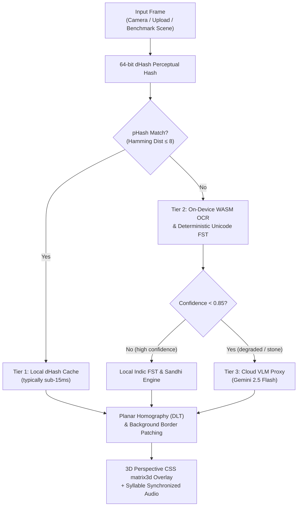

# ಲಿಪಿ ಲೆನ್ಸ್ | Lipi Lens
> **Read the city. Connect with 1,500+ years of Kannada.**  
> 💛❤️ **ಕನ್ನಡ ರಾಜ್ಯೋತ್ಸವದ ಶುಭಾಶಯಗಳು! Happy Kannada Rajyotsava!**

[]()
[](https://opensource.org/licenses/MIT)
[]()
[]()
[]()
[]()

---

## 1. Overview

**ಲಿಪಿ ಲೆನ್ಸ್ | Lipi Lens** is a client-side computer vision and computational linguistics application designed to read, translate, and explain Kannada script in the physical world. Built for Kannada Rajyotsava, it bridges the gap between everyday urban navigation and Karnataka's 1,500-year linguistic heritage.

Unlike general-purpose translation tools that dump recognized text into flat popups, Lipi Lens treats script recognition as a planar geometry and abugida morphology problem. It computes planar homography matrices to project perspective-locked translations directly onto physical surfaces—such as transit boards, storefronts, and ancient stone inscriptions—while providing interactive visual deconstructions of complex Kannada conjunct characters (*ottaksharas*) and compound words (*sandhi*).

The application operates on an edge-first cascade, combining a 64-bit perceptual hash (dHash) cache and client-side deterministic Unicode processing with an optional cloud vision fallback for heavily degraded inputs.

---

## 2. Problem Statement

Across Karnataka's urban centers and historical sites, everyday life is written in Kannada script: BMTC bus destination boards, Namma Metro signage, Darshini hotel menus, municipal street signs, and centuries-old stone inscriptions (*shilashasana*).

While millions of people in Bengaluru and Karnataka speak colloquial Kannada or recognize common phrases phonetically, reading the written script poses significant challenges. Kannada is an *abugida* where vowels modify base consonants and consonant clusters stack vertically as dependent sub-glyphs (*ottaksharas*). For new residents, students, and interstate migrants, this makes vital public transit and civic notices difficult to read in the flow of daily life.

Lipi Lens addresses this challenge by making Kannada signage readable and educational at the point of interaction.

---

## 3. Occasion: Kannada Rajyotsava

On **1 November 1956**, the Kannada-speaking regions across southern India were unified under the States Reorganisation Act into Mysore State, which was officially renamed **Karnataka on 1 November 1973**. This unification is celebrated annually as **Kannada Rajyotsava**.

Lipi Lens commemorates this occasion through several deliberate design choices:
- A celebratory design palette featuring Rajyotsava crimson (`#E11D48`) and Karnataka gold (`#FACC15`).
- Strictly bilingual user interfaces, displaying native Kannada labels first and English translations second.
- An interactive Karnataka Unity Map dedicated to the historic unified territories.
- Curated benchmark scenes featuring civic transit, culinary staples, and the 9th-century Begur hero stone.

---

## 4. Who It Is For

- **New Residents & Migrants:** People living and working in Karnataka who need to independently navigate public transit, read civic signboards, and order at local eateries.
- **Young Kannadigas & Diaspora:** Heritage speakers who speak Kannada fluently at home but did not learn to read or write the script formally.
- **Language Learners & Enthusiasts:** Anyone learning Kannada who benefits from seeing words broken down into base letters, conjuncts, and grammatical compounds.
- **History & Epigraphy Enthusiasts:** Visitors exploring Karnataka's ancient temple architecture and stone inscriptions who want to understand historical script stages.

---

## 5. Features

### 5.1 Scan and Understand (Spatial AR)
- **4-Corner Homography Overlay:** Features preset bounding polygons for benchmark scenes and draggable corner pins for perspective calibration. Uses a Direct Linear Transform (DLT) to calculate a $3 \times 3$ planar homography matrix $H \in \mathbb{R}^{3\times3}$, rendering translated English or ISO 15919 transliterations via CSS `matrix3d` so text remains locked to physical signage.
- **Background Patching:** Samples perimeter border colors around the sign boundary to cleanly patch over original lettering before overlaying readable text.
- **3D Perspective Proof:** Includes live Pitch, Yaw, and Roll sliders ($-25^\circ$ to $+25^\circ$) to prove perspective lock across varying camera angles.
- **Input Flexibility:** Supports live device camera streams (`getUserMedia`), user image uploads, and 8 pre-loaded authentic benchmark scenes (BMTC bus boards, Metro interchanges, Darshini menus, traffic warnings, silk shop boards, Begur stone inscriptions, festival banners, and street name boards).

### 5.2 Akshara X-Ray (Deterministic Abugida Deconstructor)
- **Pure Unicode FST State Machine:** Parses the Unicode Kannada block (`U+0C80`–`U+0CFF`) deterministically without neural hallucinations.
- **Constituent Decomposition:** Breaks any word into base consonants, explicit viramas (`U+0CCD`), *ottakshara* sub-glyphs, and dependent vowel signs (*matras/kagunita*), classifying length (*hrasva* vs. *dirgha*).
- **Accurate Code Points:** Strictly enforces correct Unicode codepoints, such as long-o ೋ (`U+0CCB`) versus short-o ೊ (`U+0CCA`), generating structural equations like `ಜ್ + ಯ್ + ೋ = ಜ್ಯೋ`.
- **Sandhi Rule Engine:** Explains classical Kannada compound rules implemented in the engine (e.g., *Guna Sandhi*: `ರಾಜ್ಯ + ಉತ್ಸವ = ರಾಜ್ಯೋತ್ಸವ`, `ಸೂರ್ಯ + ಉದಯ = ಸೂರ್ಯೋದಯ`; *Lopa Sandhi*: `ಮಾತು + ಇಲ್ಲ = ಮಾತಿಲ್ಲ`).

### 5.3 Kannada Kali (Learn While You Scan)
- **Lipi Journal:** Users can save any scanned sign or unfamiliar word to a persistent local study journal.
- **Spaced-Repetition Flashcards:** Implements a 5-box Leitner system with auto-scheduling to reinforce retention.
- **Complete Alphabet Path:** Guides learners through all 14 independent vowels (*swaras*), 34 consonants (*vyanjanas*, both vargiya and avargiya), and common conjuncts (*ottaksharas* like ಕ್ಕ, ತ್ತ, ನ್ನ, ಷ್ಟ, ರ್ಕ).
- **Rajyotsava 50-Word Challenge:** An interactive milestone ring encouraging learners to discover and master 50 Kannada words.

### 5.4 Kannada Through the Ages (Heritage Epigraphy)
- **Epigraphical Timeline:** Traces 1,500+ years of evolution across 5 milestones: Halmidi inscription (c. 450 CE), Kavirajamarga (c. 850 CE), Begur hero stone (c. 890 CE), Vachana era (12th century), and modern unification (1956).
- **Shilashasana Mode:** Applies Contrast-Limited Adaptive Histogram Equalization (CLAHE) and a 3D bas-relief embossing shader on weathered stone surfaces, controlled via an interactive split-screen slider.
- **Halegannada Glyph Mapping:** Maps obsolete Old Kannada letters—such as *Llla* ೞ (`U+0CDE`) and archaic *ṟa* ಱ (`U+0CB1`)—to their modern phonetic successors.
- **Sources Panel:** Cites historical references including *Epigraphia Carnatica (B. L. Rice)* and archaeological survey reports.

### 5.5 Karnataka Unity Map
- **5 Historic Regions:** Visualizes the territories unified on 1 November 1956: Old Mysore, Bombay-Karnataka (Kittur Karnataka), Hyderabad-Karnataka (Kalyana Karnataka), Coastal / Madras-Karnataka (Karavali), and Kodagu.
- **1-Tap Demo Pins:** Interactive geographic markers across Bengaluru and Karnataka that load real-world signboards directly into the 3D AR scanner.
- **Dialect Cards:** Explains regional greeting variations and vocabulary differences with audio playback.

### 5.6 Sign Intelligence Cascade
- **Tier 1 (Typically Sub-15ms):** 64-bit difference hash (`dHash`) lookup against a local perceptual cache for instant repeat recognition.
- **Tier 2:** On-device OCR execution (Tesseract.js WASM) coupled with sub-millisecond deterministic Unicode FST parsing.
- **Tier 3 (Cloud Fallback):** Confidence-gated escalation to a Vision-Language Model proxy (Gemini 2.5 Flash) only when recognition confidence falls below threshold $\tau < 0.85$ (such as degraded signage or weathered historical inscriptions), provided offline mode is not active.
- **Real-Time Telemetry HUD:** Displays actual runtime metrics—including requestAnimationFrame FPS, elapsed tier latencies, and cache hit counts.
- **Offline Edge Toggle:** An airplane mode switch that blocks network requests to demonstrate on-device operation.

### 5.7 Kanglish to Kannada
- **Phonetic Conversion:** Converts popular Roman-script Kannada phrases ("bisi bele bath", "namma metro", "swalpa adjust maadi", "oota aayitha") into standard Kannada script.
- **Colloquial Support:** Provides context notes and audio for everyday street phrases and culinary vocabulary.

### 5.8 Audio Engine
- **Bilingual TTS:** Uses the Web Speech API with native `kn-IN` voice detection and fallback mechanisms.
- **Syllable-Level Illumination:** Schedules timestamped events that illuminate each letter node in the Akshara tree synchronously as it is pronounced.
- **0.5x Slow-Motion Mode:** Slows audio playback down to half-speed for pronunciation study.
- **Formant Acoustic Synthesizer:** An offline Web Audio API harmonic oscillator fallback for synthesized letter playback when native speech voices are unavailable.

### 5.9 Accessibility
- **Audio-First Mode:** Automatically announces scanned signs and meanings aloud for visually impaired users.
- **Large Text (A+):** Dynamic font-scaling toggle for high legibility on small screens.
- **High-Contrast Theme:** High-contrast borders and elevated color brightness.
- **Accessible Mark-up:** Comprehensive `aria-label` attributes on sliders, modal triggers, and map pins.

### 5.10 Heritage Contribution
- **Preserve Kannada:** One-click archiving of signboards and location data into community preservation storage.
- **JSON / GeoJSON Export:** Exports saved signs, GPS metadata, and linguistic annotations as formatted JSON.

---

## 6. How It Works (Architecture)



### Core Algorithms Explained

1. **Planar Homography (Direct Linear Transform):**  
   Maps four source corners $(x_i, y_i)$ of a quadrilateral sign to target display bounds $(u_i, v_i)$ by solving the 8-equation linear projection system mapping a canonical rectangle $(0, 0, w, h)$ to target points $(x_0, y_0) \dots (x_3, y_3)$. The resulting $3 \times 3$ projective matrix is converted into a CSS `matrix3d(...)` transform to lock rendered DOM elements to the physical sign surface in three dimensions.

2. **Perceptual Difference Hashing (64-bit dHash):**  
   Downsamples input canvas patches to a $9 \times 8$ grayscale matrix and computes boolean gradients across adjacent columns ($P[x, y] > P[x+1, y]$). This generates a 64-bit integer fingerprint robust to brightness and minor scaling variations. Matches within a Hamming distance $\le 8$ resolve typically in sub-15ms.

3. **Shilashasana Contrast Filtering (CLAHE & Relief):**  
   Processes weathered inscription textures by calculating local luminance histograms over tiled contextual regions, clipping gradient spikes to prevent noise amplification, and applying a $3 \times 3$ directional embossing kernel:
   $$\begin{bmatrix} -2 & -1 & 0 \\ -1 & 1 & 1 \\ 0 & 1 & 2 \end{bmatrix}$$
   This technique enhances chiseled stone engravings on centuries-old granite slabs.

4. **Deterministic Unicode Akshara FST:**  
   Scans character streams across the `U+0C80`–`U+0CFF` range using an abugida transition state machine. It groups base consonants, consonant joiners (Virama `U+0CCD`), stacked *ottaksharas*, dependent vowel signs, *anusvara* (`U+0C82`), and *visarga* (`U+0C83`) into orthographic syllables without relying on language model inference.

---

## 7. Tech Stack

| Layer | Technology | Purpose in Project |
|---|---|---|
| **Frontend Framework** | React 18.3 + TypeScript 5.7 | Application state management, interactive UI, and type safety |
| **Build Tooling** | Vite 6.1 + Bun 1.4 | Rapid HMR local development and production bundle compilation |
| **Styling & UI** | Tailwind CSS 3.4 + Lucide Icons | Responsive layouts, high-contrast themes, and iconography |
| **Local OCR** | Tesseract.js 7.0 (WASM) | Client-side Optical Character Recognition |
| **Testing** | Bun Test / Vitest-compatible test suite | Unit testing for the Unicode FST and geometric computer vision algorithms |
| **Backend API** | FastAPI 0.115 + Uvicorn 0.30 (Python 3) | Proxy routing, pHash verification, and Gemini Cloud VLM fallback |
| **Image Processing (Python)** | Pillow 10.4 + NumPy 1.26 | Server-side image manipulation and perceptual hash calculations |
| **HTTP Client** | HTTPX 0.27 | Asynchronous upstream communication with cloud vision APIs |

---

## 8. Getting Started

### Prerequisites
- [Bun](https://bun.sh/) (v1.1+) or Node.js (v18+)
- Python (v3.10+)
- Git

### 1. Clone the Repository
```bash
git clone https://github.com/JdVashuu/Lipi-Lens.git
cd Lipi-Lens
```

### 2. Frontend Setup
```bash
cd frontend
bun install       # or: npm install
bun run dev       # Starts Vite dev server on http://localhost:5173
```

### 3. Backend Setup (Optional, for Cloud VLM Tier 3 Fallback)
In a separate terminal window:
```bash
cd backend
python3 -m venv .venv
source .venv/bin/activate
pip install -r requirements.txt
uvicorn main:app --host 127.0.0.1 --port 8000 --reload
```

### Environment Variables (Optional)
The application runs client-side by default. To enable Tier 3 Cloud VLM fallback calls, provide your Gemini API key in the backend environment:
```bash
export GEMINI_API_KEY="your-gemini-api-key-here"
```

---

## 9. Testing

Lipi Lens maintains a unit test suite covering the deterministic Unicode FST engine, sandhi grammar decompositions, homography matrix mathematics, and perceptual hashing.

### Running Unit Tests
```bash
cd frontend
bun test          # or: npx vitest run
```

### Test Coverage Summary
- **Total Passing Tests:** **39 / 39 Passing**
  - **FST Test Suite (35 tests):** 32 discrete real-world Kannada words tested for exact grapheme clustering, base consonant identification, and *ottakshara* recognition; explicit verification of long-o ೋ (`U+0CCB`); triple-conjunct clusters (`ಸ್ತ್ರೀ`); Guna and Lopa Sandhi rule validations.
  - **Computer Vision Test Suite (4 tests):** $3 \times 3$ homography calculation and CSS `matrix3d` string conversion; 3D Euler angle rotation (pitch/yaw/roll); 64-bit dHash and Hamming distance calculation; CLAHE pixel bounds verification.

---

## 10. Project Structure

```
Lipi-Lens/
├── frontend/                     # React + TypeScript client application
│   ├── public/                   # Static assets, PWA manifest, service worker
│   │   ├── manifest.json         # PWA installation manifest
│   │   ├── sw.js                 # Offline service worker cache
│   │   └── data/samples/         # 8 benchmark signboard images
│   ├── src/
│   │   ├── components/           # UI components
│   │   │   ├── ARCanvas.tsx           # 3D spatial AR viewport with DLT homography
│   │   │   ├── AksharaXRayTree.tsx    # Interactive abugida AST visualizer
│   │   │   ├── KannadaKali.tsx        # Lipi Journal, Leitner flashcards, alphabet path
│   │   │   ├── HeritageTimeline.tsx   # 1,500-year timeline & Shilashasana slider
│   │   │   ├── KarnatakaUnityMap.tsx  # 5 historic regions & demo scan pins
│   │   │   ├── KanglishConverter.tsx  # Roman-to-Kannada colloquial translator
│   │   │   ├── TelemetryDrawer.tsx    # Live FPS, latency, and cascade HUD
│   │   │   └── AccessibilityBar.tsx   # Audio-first, large text, and contrast controls
│   │   ├── core/                 # Core mathematical & linguistic algorithms
│   │   │   ├── kannadaFST.ts     # Deterministic Unicode FST state machine
│   │   │   ├── homography.ts     # Direct Linear Transform (DLT) matrix math
│   │   │   ├── dhash.ts          # 64-bit perceptual difference hashing
│   │   │   ├── ocrCascade.ts     # 3-Tier cascade router & telemetry tracker
│   │   │   ├── ttsEngine.ts      # Web Speech + offline formant harmonic synth
│   │   │   ├── lipiJournal.ts    # Local persistence & Leitner box logic
│   │   │   └── kanglish.ts       # Kanglish phrase dictionary & phonetic index
│   │   ├── data/                 # Curated historical data & benchmark scenes
│   │   │   ├── sampleScenes.ts   # 8 benchmark signboards with polygon points
│   │   │   ├── heritageTimeline.ts # Historical milestones & archaic glyphs
│   │   │   └── karnatakaMap.ts   # Regional dialect greetings & map coordinates
│   │   └── tests/                # Test suites
│   │       ├── fst.test.ts       # 35 Unicode FST & Sandhi unit tests
│   │       └── cv.test.ts        # 4 Computer Vision & Math unit tests
│   ├── package.json              # Frontend package dependencies & scripts
│   └── vite.config.ts            # Vite bundler configuration & backend proxy
├── backend/                      # Optional Python FastAPI proxy service
│   ├── main.py                   # FastAPI endpoints for pHash & cloud fallback
│   ├── phash.py                  # Server-side difference hash implementation
│   ├── cache.py                  # In-memory semantic cache
│   ├── kannada_morphology.py     # Python morphological analyzer
│   ├── gemini_service.py         # Gemini 2.5 Flash cloud fallback service
│   └── requirements.txt          # Python package dependencies
└── README.md                     # Project documentation
```

---

## 11. Demo Video

Demo video: [Watch the Lipi Lens demo on Google Drive](https://drive.google.com/file/d/1KWHpr7EcQ5ZzvxDFEYnPFi1IlaRq6Z1y/view?usp=sharing)

*(A ~2.5-minute demonstration video showcasing real-time homography perspective locking, Akshara X-Ray deconstruction, Leitner flashcards, Shilashasana mode, and offline edge telemetry).*

---

## 12. Limitations and Honest Notes

- **Pre-Cached Demo Signs ("demo cache"):** The 8 built-in benchmark signboards feature pre-computed perceptual hashes and calibrated quadrilateral coordinates. In the UI and Telemetry Drawer, repeat lookups from this set are explicitly identified with the label **"(demo cache)"**.
- **OCR Latency Boundaries:** While Tier 1 (cache) and Unicode FST parsing execute in sub-millisecond timeframes, running full client-side Tesseract.js WASM OCR on un-cached high-resolution images in a mobile browser typically requires several seconds depending on hardware capabilities.
- **Offline Audio Fallback:** When the browser lacks a native Kannada (`kn-IN`) Web Speech API voice pack, the app falls back to an offline harmonic oscillator synthesizer (Web Audio API). This fallback produces audible resonant formant tones for individual syllables, but does not replicate natural continuous speech.
- **Historical Epigraphy Dates:** All historical dates (e.g., Halmidi c. 450 CE, Begur stone c. 890 CE) reflect prevailing epigraphical consensus and are explicitly documented throughout the interface as **"widely cited as"**.
- **Network Boundaries:** Tier 1 (pHash cache) and Tier 2 (WASM OCR + FST) run entirely client-side without an internet connection. Tier 3 (Gemini 2.5 Flash) requires network connectivity to contact the backend proxy.

---

## 13. Heritage Sources and Acknowledgements

### Epigraphical & Historical Sources
- **Epigraphia Carnatica (B. L. Rice)**, archaeological documentation of inscriptions in Karnataka.
- **Mysore Archaeological Department reports**, documenting the Halmidi slab and Begur hero stone.
- **Kavirajamarga** (c. 850 CE), court of Rashtrakuta King Nrupatunga Amoghavarsha I.
- **Documentation of Bengaluru Inscription Stones**, preserving historical local hero stones (*veeragallu*).

### Typography & Open Source Libraries
- **Noto Sans Kannada** by Google Fonts, for Unicode-compliant typography.
- **JetBrains Mono** by JetBrains, for telemetry data and code point displays.
- **Inter** by Rasmus Andersson, for clean user interface typography.
- Built with **React**, **Vite**, **Tailwind CSS**, **FastAPI**, **Vitest/Bun Test**, and **Lucide Icons**.

---

## 14. License

This project is licensed under the **MIT License**.

```
"The language lives on in those who can read it.
Lipi Lens helps every Kannadiga, old and new, read their city."
```
